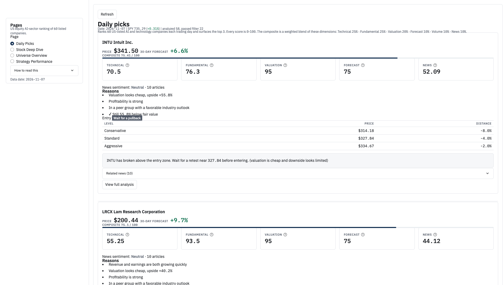
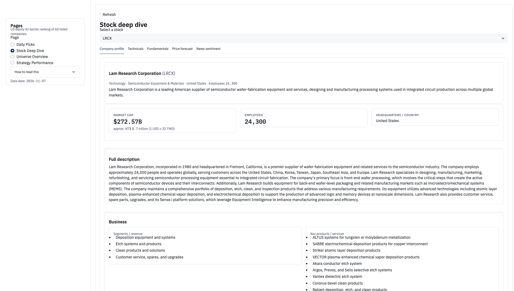
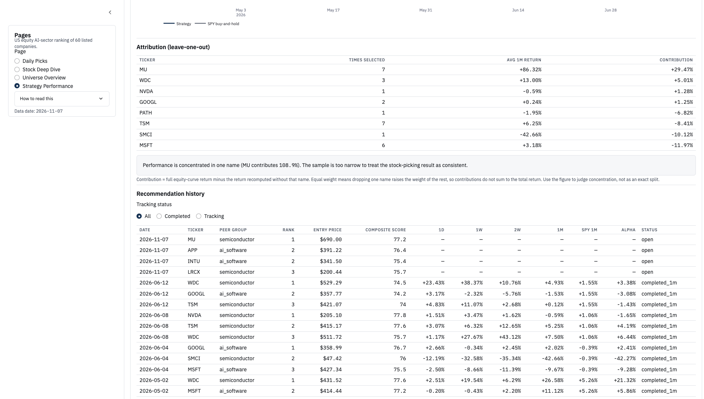

> **Static demo.** This repository is a read-only snapshot of the US Equity AI Sector Analysis System. The Streamlit app does not call market-data APIs and does not use credentials. The live demo is https://stock-dashboard-d-yxp4hduzpjpv5danzq8qlvmo.streamlit.app. Weekday refreshes may update `data/latest/` from public Yahoo Finance prices with no API key. News, sentiment, company profiles, and Prophet paths are carried forward, because that job does not run FinBERT or Claude. The committed baseline in `data/baseline/` is never removed by the daily job, so the dashboard still opens if a collection run fails. The app shows `data/latest/` when that snapshot parses, and otherwise falls back to `data/baseline/`.

## Running this static demo

```bash
pip install -r requirements.txt
streamlit run app.py
```

A failed daily job does not delete `data/baseline/` and does not replace `data/latest/` with a partial write.

---

# US Equity AI Sector Analysis System

**Live dashboard:** https://stock-dashboard-d-yxp4hduzpjpv5danzq8qlvmo.streamlit.app

A daily stock-screening dashboard for 60 US-listed AI and technology companies
(59 with usable price history),
plus the backtesting work done to find out whether its stock-selection signal
actually has predictive power.

**Short answer: it does not.** The headline backtest beats the S&P 500 by a wide
margin, but four independent controls show that excess return comes from the
stock universe, not from the ranking. This README reports that result rather
than the headline number.

---

## What the system does

**Dashboard** — Pulls daily price, fundamental, and news data for 60 tickers,
scores each on five dimensions, and surfaces the top 3 names with a written
rationale.

| Dimension | Inputs |
|---|---|
| Technical | 15+ indicators (RSI, MACD, Bollinger Bands, KD, moving averages) |
| Fundamental | ROE, gross margin, revenue growth, debt-to-equity, and 4 others |
| Valuation | P/E, PEG, analyst target price |
| Forecast | 30-day Prophet price projection |
| Sentiment | FinBERT scores on recent news, time-decay weighted |

**AI value-chain taxonomy** — The 60 tickers are organised into six layers of AI
commercialisation, from infrastructure to consumer applications:

```
Layer 1  Infrastructure      15  NVDA, AMD, AVGO, TSM, ASML, MU, SMCI …
Layer 2  Cloud & compute      8  MSFT, GOOGL, AMZN, ORCL, CRWV …
Layer 3  Foundation models    5  META, BIDU, TSLA, AAPL, PLTR
Layer 4  Data platforms      10  SNOW, DDOG, MDB, PATH, GTLB …
Layer 5  AI applications     12  CRM, NOW, ADBE, INTU, TTD, APP …
Layer 6  Consumer & content  10  SPOT, NFLX, RBLX, DUOL, SONY …
```

**Two classification axes.** The six layers organise the universe thematically,
by position in the AI value chain. Valuation uses a separate, coarser peer
grouping of three buckets — semiconductor (15), AI software (33), consumer (12)
— because P/E comparison needs enough names per bucket to be meaningful, and
because the six layers cut across very different multiple ranges. Layer 5 alone
spans names that do not share a fair-value band. The dashboard labels these
separately as Layer and Peer group.

**Track record** — Each day's picks are logged with entry price and scores, and
forward returns are backfilled at 1 day / 1 week / 2 weeks / 1 month against SPY.

## Screenshot gallery

Captured from the local dashboard on the 2026-11-07 snapshot.



*Daily picks. The day's ranking, with a score breakdown and entry levels for each name.*



*Stock deep dive. LRCX (Lam Research) on the company profile tab.*



*Strategy performance. Leave-one-out attribution. The callout warns that performance is concentrated in one name (MU, 108.9%), so the sample is too narrow to treat as consistent stock selection.*

---

## Backtest methodology

Everything below is reproducible: the window, the universe, and the cost
assumptions are fixed constants in `config.py`, not derived from the run date.

| Parameter | Value |
|---|---|
| Window | 36 complete months, 2023-09 to 2026-09 |
| Rebalance | Last trading day of each month |
| Rule | Hold top 3 by composite technical score, equal weight |
| Costs | 0.15% per side (0.05% commission + 0.10% slippage) |
| Universe | 34 large-caps (intersection of the 60-ticker list and S&P 500 membership 2022–2026) |

**Look-ahead bias testing.** Every factor passes a truncation check: the value
computed from data truncated at month *t* must equal the value computed from the
full series at month *t*. Verified across 10 factors × 36 months × 538 tickers.

---

## Results

### Headline

| | Cumulative | Sharpe | Max drawdown |
|---|---|---|---|
| Strategy (net of costs) | **209.9%** | 1.23 | −44.5% |
| SPY buy-and-hold | 85.0% | — | −18.8% |

That looks like a 125 percentage-point edge. The rest of this section is about
why it isn't one.

### Control 1 — Equal weight beats the ranking

Holding all 34 names equally weighted, same window, same costs:

| | Cumulative |
|---|---|
| Equal weight, all 34 | **225.7%** |
| Top-3 ranking strategy | 209.9% |

Picking the top 3 each month *underperforms* simply holding everything by 15.8
percentage points. The ranking subtracts value — it concentrates risk and pays
transaction costs for nothing.

### Control 2 — Random selection

Drawing 3 names at random each month from the same 34, repeated 1,000 times
(fixed seed):

| Percentile | Cumulative |
|---|---|
| 5th | 38.4% |
| 25th | 96.9% |
| 50th | 160.1% |
| **Strategy** | **209.9% → 65th percentile** |
| 75th | 249.7% |
| 95th | 435.6% |

About a third of random draws did better.

### Control 3 — Rank information coefficient

Spearman correlation between each month's score and that month's forward return,
across all 34 names:

| | |
|---|---|
| Mean IC | 0.055 |
| Std. dev | 0.261 |
| **t-statistic** | **1.25** |
| Months with IC > 0 | 66.7% (24/36) |

A t-statistic of 1.25 is indistinguishable from zero.

### Control 4 — Point-in-time S&P 500

The 34-name test has a small cross-section, so ten factors were re-tested on the
actual S&P 500 constituents as of each month-end (~486 names per month, 567
unique over the window):

| Factor | t (34 names) | t (PIT S&P 500) |
|---|---|---|
| Bollinger sub-score | 2.10 | 1.19 |
| 52-week-high proximity | 2.08 | **0.39** |
| Short-term reversal | 2.01 | 1.37 |
| Low volatility | 1.99 | 0.93 |
| 12-1 momentum | 1.55 | 1.11 |
| Moving-average sub-score | 1.55 | 0.67 |
| RSI sub-score | −1.04 | −1.19 |
| Volume trend | −0.85 | −0.69 |
| Volume sub-score | −0.22 | −1.48 |
| MACD sub-score | −0.06 | 0.63 |

Expanding the cross-section 14× should shrink the standard error by roughly 3.8×
and *raise* the t-statistic of a genuine signal. Every factor moved the other
way. **No factor reaches |t| > 1.5.** The four that clustered near t ≈ 2 on 34
names were small-sample noise.

### Return concentration

Excess return is concentrated in time rather than in any single holding:

| | Strategy | SPY, same periods |
|---|---|---|
| All 36 months | 209.9% | 85.0% |
| Excluding best 1 month | 139.7% | 78.6% |
| Excluding best 3 months | 63.6% | 52.1% |
| **Excluding best 5 months** | **19.0%** | **36.4%** |

Removing 5 of 36 months flips the result from a large win to a loss against the
benchmark. The 15 holdings across those 5 months were 13 distinct tickers, so
this is calendar concentration, not single-stock concentration.

### Start-date robustness

Rolling the start month across 25 values (2022-09 through 2024-09), holding the
end month fixed: annualised return ranges 30.7%–51.6%, Sharpe 0.90–1.34. The
baseline start month sits at the 92nd percentile — high, but not an outlier, and
the result is not an artefact of one chosen start date.

---

## Limitations

**The universe was selected with hindsight.** The 60 tickers were chosen in 2026
as AI-exposed names. The 34-name backtest universe is their intersection with
S&P 500 membership over 2022–2026, which also uses forward information — a
company added to the index in 2024 is in the universe when backtesting 2023.
The absolute return figures are inflated by this. The equal-weight control is
unaffected, since both sides draw from the same universe.

**Delisted securities are missing.** yfinance does not serve price history for
delisted tickers. Of 567 names that appeared in the S&P 500 over the window, 29
had no price data: 14 confirmed delistings or acquisitions (ATVI, PXD, WRK,
CTLT, JNPR, HES, …) and 15 with no clear cause, some of which are symbol changes
(FLT → CPAY, PEAK → DOC). Missing rate falls from 5.4% in 2023-09 to 0.2% in
2026-08. Acquisitions typically close at a premium, so this omission likely
biases returns *downward*. The same problem affects the live universe: CFLT no
longer returns price data and is dropped from the backtest, so 59 of the 60
tickers are usable.

**Only the technical dimension is backtested.** The dashboard's fundamental,
valuation, and sentiment scores cannot be backtested cleanly — yfinance returns
only current fundamentals, and historical news is not retrievable. Any backtest
of those dimensions would have look-ahead bias. The results above apply to the
technical composite only.

**The valuation model fails on cyclical earnings.** The P/E method backs out
trailing EPS and multiplies by the sector's fair multiple, which breaks when
earnings sit at a cyclical peak or trough: a memory name trading at a trailing
P/E of 8 produces a fair value more than three times its price. A plausibility
guard now flags any implied upside above +100% or below −50% as unreliable and
returns a neutral valuation sub-score instead of a bullish one, but the
underlying method remains unsuitable for cyclicals. The valuation dimension is
not backtested and should be read as a screening input, not a price target.

**Max drawdown is −44.5%** against SPY's −18.8% over the same window, a
consequence of holding 3 names with no position sizing or volatility targeting.

**Costs are modelled, not measured.** 0.15% per side is an estimate. Market
impact for a real position is not modelled.

**36 months is a short sample**, covering a single market regime. The window is
predominantly a tech bull market.

---

## Approaches tested and rejected

| Approach | Result |
|---|---|
| Event-driven exits (take-profit / stop-loss / signal decay) | A 5×5 parameter grid showed extreme sensitivity — shifting the decay window by 2 days moved cumulative return from 307% to 174%. Rejected as overfitting. |
| Defensive rotation to SPY in drawdowns | Using a real-time regime label (SPY 8% below its running high), Sharpe fell 1.23 → 1.08 and return 209.9% → 150.7%, across 6 headwind months. Rejected. |
| Removing the RSI sub-score | RSI has a negative standalone IC (−0.043) and correlates −0.86 with short-term reversal, so it looked like it was cancelling out the composite. Removing it moved IC 0.055 → 0.059; inverting it made things worse (0.052). Hypothesis rejected. |
| Re-weighting the technical composite | Dropping both the RSI and MACD sub-scores raises composite rank IC from 0.055 to 0.099 (t = 2.27), and a Bollinger + moving-average composite reaches 0.105 (t = 2.31). Both rejected. They are ex-post comparisons on the same 34-name sample, and they are built from the two factors whose significance collapsed hardest on the point-in-time cross-section (Bollinger t 2.10 → 1.19, moving average 1.55 → 0.67). Re-weighting the same noisy inputs produces a higher in-sample IC without producing a signal. |

---

## Running it

```bash
pip install -r requirements.txt
cp .env.example .env          # add API keys if using LLM summaries
python src/daily_picker.py    # generate today's picks
streamlit run dashboard/app.py
```

Backtests:

```bash
python src/backtest_compare_groups.py   # baseline, three universes, regime split
python src/backtest_robustness.py       # rolling start, concentration, controls
python src/factor_research.py           # factor ICs, 34-name universe
python src/factor_research_pit.py       # factor ICs, point-in-time S&P 500
```

Data is cached locally under `data/cache/` and `data/backtest_cache/`; the first
full run downloads several hundred tickers and takes roughly 25 minutes.

---

## Repository layout

```
config.py                        Universe, weights, fixed backtest window
src/
  data_collector.py              yfinance ingestion with caching and retries
  indicators.py                  Technical indicators and sub-scores
  fundamentals.py                Fundamental scoring
  valuation.py                   P/E, PEG, analyst-target valuation
  predictor.py                   Prophet 30-day forecast
  news_fetcher.py                News retrieval
  sentiment.py                   FinBERT sentiment + LLM summaries
  profile_fetcher.py             Company profiles
  entry_price.py                 Conservative / standard / aggressive entry levels
  daily_picker.py                Composite scoring and daily top-3 selection
  track_record.py                Recommendation logging and forward-return backfill
  backtest_signals.py            Causal factor series with look-ahead verification
  backtest_data.py               Price and score matrices
  backtest_universe.py           NASDAQ-100 historical membership
  backtest_universe_sp500.py     S&P 500 historical membership
  backtest_compare_groups.py     Monthly baseline, cost model, regime analysis
  backtest_engine_v2.py          Event-driven engine (tested, not adopted)
  backtest_robustness.py         Robustness and benchmark controls
  factor_research.py             Factor IC research
  factor_research_pit.py         Factor IC on point-in-time universe
dashboard/app.py                 Streamlit interface
```

---

## What this is and isn't

This is a research project, not a trading system. Nothing here is investment
advice. The main finding is a null result: a monthly technical-momentum ranking
over this universe and window shows no measurable stock-selection skill, and the
apparent outperformance is sector exposure.

Current work is on finding a signal that survives the point-in-time test.
